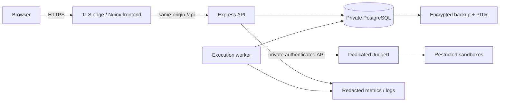

# Deployment and operations

Use one API plus a separate worker and private PostgreSQL. Only the worker network can reach private Judge0. Sandboxes cannot reach application data, metadata or public networks. No database credentials are passed to Judge0.

## Rollout

Build API/worker from the root Dockerfile and frontend with `docker build -f apps/web/Dockerfile .`. The root `migrations` target retains the migration tool; runtime runs as the Node user. Worker command: `node apps/api/dist/worker.js`. Builds remain unverified here.

Provide private PostgreSQL/SMTP settings, `NODE_ENV=production`, HTTPS `APP_ORIGIN`, `COOKIE_SECURE=true`, `MAIL_MODE=smtp`. Bind API to `0.0.0.0` only inside a restricted container network. Nginx expects the service `api:4000`; terminate TLS at the edge. Set only the actual trusted proxy-hop count; default is zero. Nginx replaces forwarded IP headers. Verify client-IP handling with the chosen edge.

Run reviewed migrations before rollout. Import verified PDFs/catalog in a separate trusted seed/bootstrap job for a fresh institutional database. Runtime startup does not create accounts/content. Retain the previous application image, use additive/backward-compatible migrations and preserve published snapshots during rollback.

CI uses lockfile installs, build/typechecks, database/browser tests and dependency auditing with read-only repository permissions. Pin reviewed action/image digests before institutional rollout. Remote CI and container execution are pending. Official guidance: [checkout](https://github.com/actions/checkout), [Node setup](https://github.com/actions/setup-node).

## Monitoring

Structured request logs contain method, route template, opaque request ID, status and elapsed time. Bodies, query strings, code, passwords, tokens, emails and connection URLs are excluded. Admin health reports recent process p95/counts, database connectivity, queue/running counts and infrastructure failures. Worker heartbeats report connection/toolchain failures without credentials.

Set external alerts for sustained 5xx/save failures, API p95 >=500 ms, acknowledgment p95 >=1 second, queue depth/age, stale worker, executor failures, disk and database health. Process-local p95 is not a certified load-test result. Current rate-limit storage assumes one API instance; add shared/edge limiting before horizontal scaling.

## Backup and retention

Production requires encrypted storage/backups, least-privilege identities, nightly snapshots and WAL/PITR with RPO <=1 hour. Demonstrate RTO <=4 hours with timed isolated staging restores. The local restore drill validates development recovery only.

PRD retention defaults: learning records 12 months after course end, raw code/output 90 days, audit events 180 days. The PRD omits a canonical course-end timestamp and explicitly requires institutional policy confirmation. Confirm those decisions before implementing/enabling scheduled purge/anonymization. Never infer course-end dates from term labels. Retention implementation remains an open release gate; no destructive scheduler is enabled.

## Live executor gate

Record deployed version/patch level, language inventory and enforced CPU/memory/process/file/network settings. Test all four compilers, correct/incorrect solutions, compiler errors, loops, processes, memory/output exhaustion, network/metadata and unauthorized files. Test worker termination during creation/polling, expired leases, overload and host outages. Jobs must settle within 90 seconds, without duplicate uncertain execution. Inspect actual responses/logs for hidden-test secrecy.
