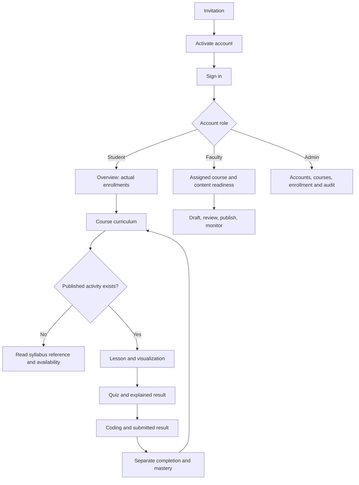
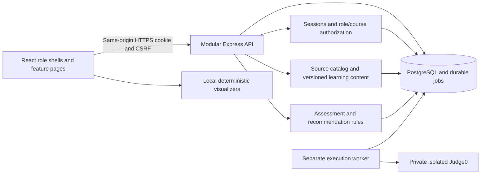

# AlgoLearn UI/UX specification

Design baseline: the supplied PRD, its architecture, and four K.K. Wagh Pattern 2023 syllabus PDFs. This document fixes layouts and interaction rules before the first application slice. Implementation status belongs in the README. Conceptual future pages below are not claims that those features already work.

## Design direction

A calm academic workspace: warm white surfaces, dark slate typography, indigo actions and restrained teal accents. Content has clear hierarchy, generous spacing and one primary next action. Avoid decorative dashboards, fabricated statistics, streaks, leaderboards and AI claims. The course/topic context stays visible across Learn, Visualize, Quiz and Code.

### Tokens

| Token                               | Value / use                                                                        |
| ----------------------------------- | ---------------------------------------------------------------------------------- |
| Canvas / surface / subtle           | `#F6F7FB` / `#FFFFFF` / `#EEF2FF`                                                  |
| Main / secondary text               | `#172033` / `#526078`                                                              |
| Primary / hover                     | `#4338CA` / `#3730A3`; white button text                                           |
| Accent / success / warning / danger | `#0F766E` / `#166534` / `#92400E` / `#B91C1C`; pale matching surfaces              |
| Decorative border / control border  | `#E2E8F0` / `#64748B`; interactive boundaries use stronger border                  |
| Focus                               | 3px `#4338CA` outline with 3px surface gap                                         |
| Type                                | System sans stack initially; optional locally hosted Inter; monospace editor stack |
| Scale                               | Hero 32/40, page 28/36, section 20/28, body 16/24, label 14/20, caption 12/18 px   |
| Spacing                             | 4, 8, 12, 16, 24, 32, 48 px                                                        |
| Radius                              | Buttons 10px, cards 16px, large panels 20px                                        |
| Elevation                           | Borders by default; subtle shadow for floating menus/dialogs, never heavy blur     |

Verify actual token pairings rather than assuming a palette guarantees contrast. Normal text targets 4.5:1; large text and meaningful non-text controls target 3:1. Interactive targets use at least 44px as a product usability standard. Support zoom/reflow and visible unobscured focus. [WCAG 2.2 reference](https://www.w3.org/WAI/WCAG22/quickref/)

## Navigation and responsive shell

Desktop ≥1024px: 240px sidebar, 72px topbar, 32px content padding, main content maximum 1280px. Standard pages use 12 columns with 24px gutters. Workspace pages can fill the available width. Topbar contains current section, account menu and sign out; course context belongs in the page header. No global search until it has a complete working feature.

Tablet 768–1023px: compact 80px navigation rail with labeled tooltips, 24px gutters; two-column cards. Below 768px: hamburger opens a labeled modal navigation drawer, 16px padding, one column, full-width forms. Close drawer on route change; return focus to trigger on dismissal. Do not depend on hover. At 320px, only visualizer/editor/table interiors may scroll horizontally; the page itself must fit.

| Role    | Global navigation                                                            | Course navigation                                   |
| ------- | ---------------------------------------------------------------------------- | --------------------------------------------------- |
| Student | Overview, My courses, Progress, Account                                      | Curriculum → topic; Learn / Visualize / Quiz / Code |
| Faculty | Overview, My courses, Curriculum references, Account                         | Curriculum & content, Students, Publication         |
| Admin   | Overview, Users, Courses & enrollment, Curriculum references, Audit, Account | Course details, faculty assignments and membership  |

Only implemented, authorized destinations enter the live navigation. A role is determined by the account; the UI cannot grant access with a role selector. Later health appears when real executor/service health is integrated. Students browse curriculum through enrolled courses; staff browse all imported references. Archived courses show a persistent read-only banner.

Breadcrumb: My courses → course → unit → topic. Official provenance adds year, semester, subject code and source page without crowding the breadcrumb. Preserve course/revision context in direct links.

## Page inventory and layouts

| Page                          | Layout and primary action                                                                                            | Empty/error behavior                                                                            |
| ----------------------------- | -------------------------------------------------------------------------------------------------------------------- | ----------------------------------------------------------------------------------------------- |
| Login                         | Centered 440px form; brand, short purpose statement, email/password, show password, Sign in, recovery link           | Generic failed-login message; preserve email; focus error summary                               |
| Activation                    | Account invitation explanation, token obtained from link, password/confirmation, Activate account                    | Expired/used link gives request-new-invitation guidance; no open signup                         |
| Request reset / confirm reset | One-purpose form; same response for any email; new password fields on confirmation                                   | Explicit link expiry; confirmation returns to login                                             |
| Student overview              | Greeting, enrolled course count, Continue learning if available, up to three explained recommendations, course cards | No enrollment: explain faculty/admin enrollment; no invented scores                             |
| My courses                    | Cards showing term, official subject association and real activity availability; Open curriculum                     | No course implies no progress; archive tag with readable history                                |
| Course curriculum             | Course header, source metadata, unit accordions, topic rows and activity chips                                       | “Syllabus reference — learning activity not yet published”; never treat as a failed requirement |
| Topic Learn                   | Main lesson 8 columns; objectives, prerequisite links and three completion requirements in 4-column side panel       | Missing content is unavailable, not an empty working lesson                                     |
| Visualizer                    | Inputs row; 8-column simulation; 4-column pseudocode/step panel; playback footer and transcript below                | Inline validation with explicit correction; simulation begins paused                            |
| Quiz                          | Main question card 8 columns; 10-question outline and save status in 4 columns; sticky Next/Previous                 | Resume own unfinished attempt; block final submit until pending saves settle                    |
| Results / history             | Score, mastery/evidence explanation, answer review, next action; paginated attempt history                           | No attempt: link to available quiz; infrastructure issue never grades answers                   |
| Coding workspace              | Problem pane 35%, editor 65%; editor toolbar then editor then input/output/results bottom pane                       | Restore per-language draft; queue unavailable state and meaningful recovery                     |
| Student progress              | Course selector; topic rows with separate completion and mastery; evidence and latest attempt                        | “Not assessed” with reason; never show zero as an estimated skill score                         |
| Faculty overview              | Assigned courses, content readiness, student attention table derived from actual records                             | No assigned course: administrator assignment guidance                                           |
| Curriculum/content editor     | Ordered unit/topic tree left; form center; preview/validation right; Save draft and Publish                          | Separate official read-only references from editable lessons; publish errors link to fields     |
| Faculty students/detail       | Enrollment list → student course progress, quiz history and coding results                                           | Never expose students outside assigned courses; unassessed is not weak                          |
| Admin overview                | Actual account/course/source totals and operational links                                                            | No synthetic operational uptime or executor health                                              |
| Users                         | Filter/list; Invite user form; row Active/Pending/Deactivated status and contextual actions                          | Duplicate email error; self-deactivation blocked; invitation delivery explained                 |
| Courses/enrollment            | Course list; create details + select official subjects; course member form, faculty/student role                     | Role compatibility checked; no arbitrary self-enrollment                                        |
| Curriculum references         | Year/semester/pathway filters; subject list; unit topics and source text detail                                      | Source gaps and code conflicts visibly labeled; elective options not cumulative compulsory load |
| Audit / health                | Audit chronological list; later health with actual queue/failure metrics                                             | Bounded pagination; no secrets or student source code in audit                                  |
| Account                       | Name/role readout, password change and reduced-motion preference                                                     | Password change revokes sessions and returns to sign-in                                         |

### Student overview wireframe

```text
┌ Navigation ┐  Overview                                  Account
│ Overview   │  Good morning, [name]
│ My courses │  Your curriculum, one clear next step at a time.
│ Progress   │  ┌ Continue [topic] — reason — Resume ──────────┐
│ Account    │  └ Only shown when a published activity exists ┘
│            │  [Enrolled courses] [Completed topics] [Assessed topics]
│            │  My courses                      Recommended next
│            │  [Course • term • Open curriculum] [Reason + destination]
│            │  [Course • term • Open curriculum] [At most three actions]
└────────────┘  Completion is a learning checklist; mastery is quiz evidence.
```

When no activities have been published, replace Continue and recommendations with a concise readiness notice. Course cards still open authentic syllabus data. Completion is “lesson acknowledged + quiz submitted + one coding problem accepted.” Mastery is a separate formative estimate, requiring sufficient question-family evidence. Watching an animation never improves it.

### Curriculum organization

Maintain program → year → semester → subject → numbered unit → source topic groups, with conditional exits outside semesters. Staff see all elective alternatives; course enrollment chooses applicable subjects without suggesting every option is compulsory. Preserve original course codes and source variants. Labs with assignment lists have an “Activities / source details” section, not invented Unit I–V.

Learning activities are separately mapped to syllabus references. FY `2300118A`, Unit IV (page 42) supports linear/binary search and insertion/selection sort. Its “Exchange” wording is preserved. Bubble is explicitly supported by SY Java Lab (`2301214`, page 47) and Data Structures Lab (`2301215`, page 51). Merge is explicit in SY Data Structures (`2301212`, page 42). TY HPC parallel sorting is related reference material, not a claim the sequential MVP demonstrates parallel execution. All four PDFs inform the navigation; syllabus topic lists are not ready-made reviewed questions or test cases.

### Visualizer interaction

Inputs: comma/space-separated integers, target for search, Apply input. Accept 1–50 values in −999..999. Edit pauses and resets immediately; explicit Apply validates the new trace. Binary search on unsorted input shows “Binary search needs sorted input” plus Sort input; never sort silently. Reset preserves input/speed and returns to step zero. Prev/Next move exactly one trace step. Disable Prev at zero and Next/Play at terminal state, with text explaining completion. Changing speed preserves current step.

Represent values as labeled array cells, optional bars around a visible zero baseline. Negative values and zero retain visible labels. Index labels are zero-based; duplicate values have stable element identities. Roles are labeled “current”, “candidate”, “sorted”, “left/right range”; color is supplemental. Linear/binary return the first matching index. Merge shows active partitions and auxiliary values, alongside a textual operation explanation. Pseudocode highlighting and transcript come from the same deterministic trace index.

For 50 items, allow an internally scrollable simulation with a compact full-array overview and current range text. Mobile stacks inputs, simulation, playback, explanation and pseudocode; transcript remains reachable. Playback does not hijack page scrolling. Space toggles only when the focused simulation control owns that shortcut; Arrow keys step only in that region. Pause when page is hidden and require user action to resume.

### Quiz interaction

Ten single-answer questions, one question card at a time; outline permits revisiting. Each radio option has a full clickable label. Show “Saving”, “Saved”, or “Not saved — Retry” after every selection. Previous/Next never imply saving succeeded. Blank answers are visibly unanswered; final confirmation names their count and explains they score as incorrect. Submit only after confirmed saves or explicit recovery. The server's completed attempt is authoritative; duplicate clicks cannot grade twice.

Results show quiz score, each answer and explanation, and separate mastery/evidence. Distinguish weak <60%, developing 60–79%, estimated mastery ≥80%, insufficient evidence, and unassessed. Explain repetition deduplication in a Details disclosure. Historical results remain tied to their original revision. Recommendations have a reason and destination, never just “AI suggests”. No timers or exam/proctoring patterns in the formative MVP.

### Coding interaction

```text
Course / Topic / Problem                     Saved / save error
┌ Problem statement 35% ┐ ┌ Language ▾ | Run ▾ | Submit solution ┐
│ Input/output format  │ │ Monaco editor                       │
│ Constraints          │ │                                     │
│ Three sample cases   │ ├ Custom input | Output | Test results ┤
│ Topic/source context │ │ Queue state / stdout / diagnostics   │
└──────────────────────┘ └─────────────────────────────────────┘
Submission history: immutable source snapshot, language, verdict, timestamp
```

Run menu: custom input or three sample tests. Submit runs eight tests (three sample, five hidden); acceptance requires all pass. Hidden cases show only case number and verdict, never input/expected/stdout/stderr. Compilation, runtime, wrong-answer, resource-limit and infrastructure failures have distinct labels. Real queued/running/finished states replace fake percentage loaders. Retain editable current draft while displaying the submitted immutable snapshot as a distinct record.

Save after two seconds idle; changing language loads its own draft. A 409 offers review of local and newer saved versions and explicit choice, never silent overwrite. Refresh restores outstanding runs/history. Maximum two outstanding jobs and five requests/minute are shown when a limit is reached, with actual retry guidance. After 90 seconds use the recorded terminal infrastructure failure. Console text is plain text with a truncation notice at the output cap. Monaco keyboard exit instructions are adjacent to the editor. Mobile switches Problem/Editor/Results panels with visible labels and preserves draft state; no mandatory split panes on a small screen.

### Staff workflows

Faculty publishing: select references → order learning topics → objectives/prerequisites → lessons/questions/problems → review validation → publish immutable revision. Provide button-based Move up/down in addition to optional drag. Validate no prerequisite cycles and every topic's question difficulty coverage/problem readiness. Confirm which revision becomes active and preserve historical attempts. Official source text is read-only, never overwritten by author edits.

Administrator invitations deliver a single-use activation link. Development delivery uses a loopback-only local email preview without displaying storage paths; production uses authenticated SMTP. Deactivation confirmation names the account and explains immediate session revocation. Membership creation offers only role-compatible existing users. Course archive confirmation explains read-only access and disallows new learning mutations. Source inconsistencies are labeled “Needs faculty confirmation”; they must not silently become authored teaching content.

## Motion specification

Use the open-source Motion for React package, imported from `motion/react`; no duplicate Framer Motion installation or paid components are required. Set the global reduced-motion policy explicitly to respect the user: the library default does not do this. [Motion configuration](https://motion.dev/docs/react-motion-config)

| Interaction     | Normal motion                                            | Reduced motion                         |
| --------------- | -------------------------------------------------------- | -------------------------------------- |
| Page enter      | 180ms opacity + 8px vertical movement; shell stays fixed | Instant or ≤80ms opacity               |
| Card reveal     | 180ms; 35ms stagger, at most six visible cards           | No stagger or movement                 |
| Hover / press   | 100ms 2px lift on pointer hover; 80ms subtle press       | Border/background feedback only        |
| Dialog / drawer | 160ms opacity and small movement                         | Instant position; short fade optional  |
| Progress        | 400ms width/scale from previous confirmed value          | Immediate confirmed value              |
| Algorithm step  | Move labeled elements in ≤75% of step interval           | Immediate state change plus transcript |
| Save / result   | Brief opacity change, stable geometry                    | Immediate text/icon update             |

Algorithm base interval 600ms, speed 0.25×–4×. Domain trace steps advance independently of decorative animations; no skipped steps or outcomes caused by animation callbacks. At 4×, transitions finish within 112ms. Pause snaps any in-flight presentation to its current committed step without advancing. Reset and previous step cancel obsolete transitions. No infinite pulse/shimmer, parallax, animated background or unsolicited playback. Step controls and transcript offer a fully usable alternative to playback.

Apply reduced-motion checks explicitly to algorithm movements, animated bars and custom effects, and respond to preference changes during a session. Account preference can request reduced motion even if the OS does not. [Motion reduced-motion guidance](https://motion.dev/docs/react-use-reduced-motion)

## Components and recovery

Reusable components: AppShell, PageHeader, Breadcrumb, Button, labeled Input/Select/Radio, Card, StatusBadge, ProgressMeter, CourseCard, UnitAccordion, TopicRow, DataTable, Dialog, Alert, EmptyState, SaveStatus, StepControls, CodeConsole and Pagination. Variants include disabled/loading/error/focus and read-only; icons always have accompanying text or accessible labels. Tables support wrapping and internal scrolling; narrow screens prefer labeled cards for user/course records.

| State                 | Required presentation and recovery                                                                |
| --------------------- | ------------------------------------------------------------------------------------------------- |
| Initial loading       | Static skeleton preserving layout; contextual accessible loading text                             |
| API error             | Inline alert, real Retry action; preserve last confirmed data and distinguish it as stale         |
| Offline / failed save | Persistent “Not saved”; keep local work, retry safely; do not claim persistence                   |
| Expired session       | Return to sign-in; no hidden privileged content; recover safe unsent work after authorized return |
| Forbidden / missing   | Dedicated readable state; Back to overview; no data leaked in error                               |
| Draft conflict        | Side-by-side or stacked versions with explicit resolution                                         |
| Archived              | Visible read-only banner; no mutable actions                                                      |
| Unavailable activity  | Plain readiness explanation; never an enabled dead button                                         |
| Unassessed            | “Not assessed”; evidence count; no fake percentage                                                |
| Executor unavailable  | Service notice; preserve draft; distinguish from incorrect code                                   |

## Accessibility, performance and handoff gates

Skip link targets main content. Use landmarks, one h1, meaningful headings, native forms, associated labels and error summaries. Restore focus after dialogs; route changes focus the page heading. Do not announce every playback frame; announce manual steps and paused/terminal results, while maintaining a readable transcript. Explanations and progress never rely solely on color. Avoid trapping users inside Monaco. Test keyboard, a screen reader, 200% zoom, 400% reflow, narrow viewports and reduced motion.

Lazy-load Monaco and visualizer pages. Animate opacity/transforms rather than repeated DOM layout. At most 50 array elements; scope simulation state and cancel timers when leaving. Dashboard refresh must not replay card entrances or animate invented score changes. No heavy images or backdrop filters. Validate on a modest laptop and mobile device; field response/saving and API requirements take precedence over cosmetic transitions.

Design handoff frames: login/activation/recovery; each role overview; course curriculum open/closed unit; topic Learn; all six visualizer states; quiz/resume/unsaved/submit/results; workspace custom/sample/hidden result/conflict; faculty editor/readiness/student detail; admin invite/course/membership/source issue/audit; forbidden/offline/empty. For each page family provide 1440px desktop, 768px tablet and 375px mobile layouts, component variants and focus order.

Acceptance: every live navigation item resolves; core journeys work by keyboard; no page-level horizontal overflow at 375px; no fake data; reduced motion removes spatial movement; saved status reflects server acknowledgments; completion and mastery remain separate; PDF source conflicts remain visible. Test at least ten representative students against the PRD's 90% unaided learning-loop target once all activity milestones are complete.

## User flows



## Architecture constraints for design



The client does not grade quizzes, issue permissions or contact Judge0. Visibility rules complement server authorization. Animation is presentation only and cannot change learning state.
