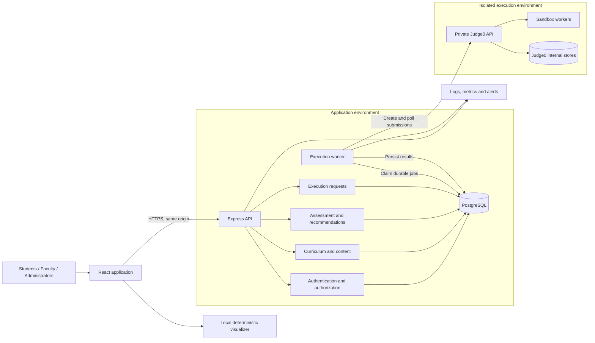

# AlgoLearn — Product Requirements Document

**Product:** Curriculum-Integrated Adaptive Learning and Simulation System  
**Release:** MVP v1.0  
**Purpose:** Guide product design, implementation, testing, and pilot deployment.  
**Planning assumptions:** One institution per deployment; undergraduate algorithms courses; English interface; formative assessment; initial capacity of 500 registered students and 100 concurrent users.

## 1. Problem, goals, and users

Students often learn algorithms through disconnected lectures, animations, quizzes, and coding tools. They struggle to connect an algorithm’s execution with its implementation and identify what to study next. Faculty lack a consolidated view of progress against their curriculum.

AlgoLearn connects **learn → visualize → assess → code → review** within faculty-defined course sequences.

**MVP goals**

- Explain algorithm behavior through accurate, controllable simulations.
- Identify topic weaknesses and recommend actionable next steps.
- Provide reliable coding practice in C, C++, Java, and Python.
- Show faculty which students and curriculum topics need attention.
- Support administration without requiring routine database access.

| Role | Primary needs | Access boundary |
|---|---|---|
| Student | Study assigned topics, practice, receive feedback, track progress | Enrolled courses and own learning records |
| Faculty | Configure curriculum, maintain assessments, monitor students | Courses they teach and enrolled students’ records |
| Administrator | Manage accounts, faculty assignments, courses, platform health | Institution-wide administrative access |

Faculty cannot change account roles. Students cannot enroll themselves into arbitrary courses or access peers’ submissions.

## 2. MVP scope and priorities

**P0 and P1 are both required for release.** P0 establishes the complete learning loop; P1 makes it usable and operable.

| Priority | Included features |
|---|---|
| P0 | Account activation, login, password reset, role enforcement, course enrollment |
| P0 | Ordered curriculum with topic objectives, lessons, and prerequisite mappings |
| P0 | Six visualizers: linear search, binary search, bubble sort, selection sort, insertion sort, merge sort |
| P0 | Topic quizzes, server-side scoring, attempt history, weakness detection, rule-based recommendations |
| P0 | Four-language editor, draft saving, custom-input execution, sample tests, hidden-test submission |
| P0 | Faculty course configuration, question/problem authoring, publication, student progress dashboard |
| P1 | Administrator account/course management, execution health, audit history |
| P1 | Accessible responsive interface, loading/error states, recovery, operational monitoring |

**Launch content:** Six lessons and visualizers, 120 reviewed questions—20 per topic—and 12 coding problems—two per topic. Each problem includes a specification, starter code for four languages, three sample tests, and five hidden tests.

Visualizers are shipped implementations. Faculty may edit lessons and assessment content but cannot upload executable visualization scripts.

**Future enhancements:** Graphs and trees, algorithm tracing from student code, multi-file projects, debugging, machine-learning adaptation, AI tutoring, spaced repetition, LMS/SSO integration, graded examinations, plagiarism detection, collaboration, native mobile apps, and multi-institution SaaS tenancy.

## 3. Functional requirements and user stories

### Curriculum and access

**Stories:** “As a student, I want a course sequence matching my syllabus.” “As faculty, I want to map topics to learning objectives and see progress.”

- Faculty select catalog topics, organize units, define objectives, and set prerequisites.
- Students see only published curriculum and their enrollment.
- Prerequisites influence recommendations; they do not prevent exploration.
- Publication validates content availability and rejects cyclic prerequisites.
- Referenced published content is immutable; edits create revisions.
- Existing attempts and submissions retain their original content revision.

**Topic completion:** Lesson acknowledged, at least one quiz submitted, and at least one coding problem accepted. Completion and estimated mastery are displayed separately.

### Interactive visualizer

**Story:** “As a student, I want to inspect each algorithm operation so I understand how the result is produced.”

- Controls: play, pause, next step, previous step, reset, and 0.25×–4× speed.
- Show array state, active indices, comparisons, swaps or merges, pseudocode highlighting, step explanation, and complexity.
- Accept 1–50 integers from −999 to 999; search visualizers also accept a target.
- Binary search rejects unsorted input and offers an explicit “Sort input” action.
- Searching reports the first matching index or “not found.”
- Editing input stops playback and resets the trace.
- Reset preserves input and returns to step zero; speed changes preserve the current step.
- Simulations run locally and deterministically from a versioned trace model.
- Visualization engagement never increases mastery automatically.

### Adaptive assessment

**Story:** “As a student, I want feedback that identifies weak topics and tells me what to do next.”

- MVP questions are single-answer multiple choice, tagged by topic, objective, and difficulty.
- Each published topic has at least six easy, seven medium, and seven hard questions.
- Each quiz contains ten distinct questions, selected server-side.
- Answers autosave; an unfinished quiz resumes after refresh.
- Submission scores all questions equally; unanswered questions are incorrect.
- Explanations and correct answers appear only after submission.
- Submission is idempotent and updates progress atomically.

**Adaptation rules v1**

| Topic state | Quiz mix: easy / medium / hard | Suggested action |
|---|---:|---|
| Unassessed | 6 / 4 / 0 | Complete diagnostic practice |
| Weak: score <60% | 6 / 4 / 0 | Review lesson and visualization, then retry |
| Developing: 60–79% | 3 / 4 / 3 | Practice explanation questions and coding |
| Mastered estimate: ≥80% | 2 / 4 / 4 | Attempt challenge practice or next topic |

Calculate the score from the latest answers to up to 20 distinct question families within the last five completed attempts. Repeated questions and revised versions of the same question contribute only their latest answer. Fewer than ten distinct answered questions means insufficient evidence.

Selection favors questions absent from the immediately preceding attempt; reuse is allowed when necessary to satisfy the difficulty mix.

Recommendations return up to three actions:

1. Address an unassessed or weak prerequisite.
2. Address the lowest-scoring available topic.
3. Advance to the next curriculum topic when prerequisites are sufficiently assessed.

Break ties by curriculum order. Every recommendation includes its reason and destination. Students may override it. Coding outcomes remain separate from quiz mastery in v1; the estimate is formative, not a validated proficiency credential.

### Coding workspace

**Story:** “As a student, I want to implement an algorithm, run it, and understand failures without installing compilers.”

- Monaco editor with language selection, syntax highlighting, starter code, and keyboard access.
- Store independent drafts for each student/problem/language; save after two seconds of inactivity.
- Changing language restores that language’s draft.
- **Run:** Execute custom input or sample tests and show output, compilation errors, runtime errors, time, and memory.
- **Submit:** Evaluate all eight problem tests using immutable problem revisions.
- Comparison normalizes line endings and ignores trailing whitespace per line; all other differences matter.
- Accepted requires every test to pass. Partial pass counts are practice feedback.
- Hidden inputs and expected outputs never reach the browser; hidden failures show only case number and verdict.
- Refresh restores submission status and history.
- Infrastructure failure is reported separately from an incorrect solution and does not reduce learning progress.

### Faculty and administration

**Stories:** “As faculty, I want to identify students needing help.” “As an administrator, I want to manage access and detect execution failures.”

- Faculty view enrollment, completion, topic mastery, quiz history, and coding results within assigned courses.
- Faculty create and revise lessons, questions, problems, and test cases.
- Administrators create/deactivate accounts, assign faculty, manage enrollments, archive courses, and inspect service health.
- Deactivation immediately revokes sessions. Archived courses remain readable but reject new attempts.
- Every role, enrollment, publication, and administrative change creates an audit event.

## 4. Page inventory and flows

| Page | Main content/actions |
|---|---|
| Login, activation, password reset | Account access and recovery |
| Student dashboard | Courses, continue learning, recommendations |
| Course overview | Units, objectives, prerequisites, completion |
| Topic lesson | Explanation, complexity, linked activities |
| Visualizer | Input, trace, controls, accessible step transcript |
| Quiz | Questions, saved status, submission |
| Quiz results/history | Score, explanations, topic trend, next action |
| Coding workspace | Problem, editor, input, output, test results, history |
| Student progress | Completion and mastery by course/topic |
| Faculty dashboard | Course summaries and students needing attention |
| Curriculum/content editor | Topic order, objectives, revisions, publication |
| Faculty student detail | Authorized student activity and results |
| Administration | Accounts, courses, memberships, audit and health |
| Profile | Name, password, accessibility preferences |

**Student:** Activate account → open enrolled course → study topic → explore simulation → take quiz → review recommendation → solve coding problem → inspect progress.

**Faculty:** Create course → select and order topics → map objectives/prerequisites → review content → publish → enroll students → monitor progress → revise content.

**Administrator:** Create accounts → assign course faculty → manage enrollment → inspect health/audit → deactivate or archive when needed.

Direct activity links preserve course context. Empty courses, unavailable execution, expired sessions, and failed saves have explicit recovery actions.

## 5. Practical stack

| Layer | Selection | Reason |
|---|---|---|
| Frontend | React, TypeScript, Vite, Tailwind CSS | Shared types, reusable interfaces, straightforward deployment |
| Editor | Monaco | Consistent browser coding experience |
| Backend | Node.js 24 LTS, Express, TypeScript | One application language and a small, maintainable API |
| Data | PostgreSQL with Prisma migrations | Relational integrity and efficient curriculum/progress reporting |
| Background work | Separate Node worker using PostgreSQL-backed jobs | Durable asynchronous execution without another application queue service |
| Execution | Judge0 CE on a dedicated isolated Linux host | Dedicated compilation/execution boundary for four languages |
| Testing | Vitest, API integration tests, Playwright | Covers domain logic, contracts, and complete user journeys |

Use maintained dependency releases, lock versions, and verify compatibility before implementation. Node’s official guidance recommends LTS releases for production. [Node.js release guidance](https://nodejs.org/en/about/previous-releases)

PostgreSQL is preferable to MongoDB because memberships, curriculum mappings, attempts, and results are strongly relational. Use JSONB only for flexible content such as option lists and starter-code maps. [PostgreSQL JSON types](https://www.postgresql.org/docs/current/datatype-json.html)

## 6. System architecture

Use a modular monolith plus independently deployable worker. The browser never calls Judge0 directly.

Creating a submission and its job is one database transaction. Workers claim jobs with leases, persist Judge0 tokens, poll results, and recover expired leases. Retry transient reads with bounded backoff; never blindly resubmit an ambiguous creation request. Mark unresolved creation as an infrastructure failure.

Scale API instances and workers independently. Judge0 capacity is governed by global concurrency limits.

## 7. Database schema

All primary keys are UUIDs; timestamps are UTC. Foreign keys enforce relationships. Common fields include `created_at` and `updated_at`.

| Table | Essential fields |
|---|---|
| `users` | email unique, password_hash, name, role, status |
| `sessions` | user_id, hashed_token, expires_at, revoked_at |
| `auth_tokens` | user_id, purpose, token_hash, expires_at, used_at |
| `courses` | code unique, title, term, status, published_revision_id |
| `course_memberships` | course_id, user_id, member_role; unique course/user |
| `course_revisions` | course_id, revision_number, status, published_at |
| `topics` | slug unique, title, visualizer_key, visualizer_version |
| `course_topics` | course_revision_id, topic_id, unit, position, objectives, lesson_revision_id |
| `topic_prerequisites` | course_revision_id, topic_id, prerequisite_topic_id |
| `lesson_revisions` | topic_id, revision_number, body, author_id |
| `questions` | family_id, revision_number, topic_id, objective_key, difficulty, prompt, options, correct_option, explanation, status |
| `course_questions` | course_revision_id, question_id |
| `quiz_attempts` | student_id, course_revision_id, topic_id, status, score, rules_version, submitted_at |
| `quiz_items` | attempt_id, question_id, position, selected_option, is_correct |
| `problems` | family_id, revision_number, topic_id, statement, starter_codes, limits, status |
| `course_problems` | course_revision_id, problem_id |
| `test_cases` | problem_id, position, input, expected_output, visibility |
| `code_drafts` | student_id, course_id, problem_id, language, source, version |
| `submissions` | student_id, course_id, problem_id, language, mode, source, custom_input, status, verdict, passed_count, total_count |
| `submission_cases` | submission_id, test_case_id nullable, judge_token, status, verdict, permitted_output, time, memory |
| `execution_jobs` | submission_id unique, state, attempts, lease_until, deadline_at, last_error |
| `topic_progress` | student_id, course_id, topic_id, lesson_acknowledged_at, mastery_score, evidence_count, mastery_state, completed_at, rules_version |
| `audit_events` | actor_id, action, entity_type, entity_id, metadata, timestamp |

**Constraints and indexing**

- Unique question family/revision, problem family/revision, quiz position, draft student/problem/language, and progress student/course/topic.
- Scores remain within 0–100; difficulty and status use controlled enums.
- Only one unfinished quiz per student/course/topic.
- Index memberships by user, attempts/submissions by student and creation time, and jobs by state/lease.
- Correct answers and hidden tests are server-only fields.
- Derived progress is reproducible from source records; recommendations are computed, not stored as authoritative data.
- Published revisions cannot be modified or hard-deleted while referenced.

## 8. API design

REST JSON under `/api/v1`; publish an OpenAPI contract before frontend integration.

| Method and route | Purpose / authorization |
|---|---|
| `POST /auth/login`, `/logout`, `/activate` | Session lifecycle |
| `POST /auth/password-reset`, `/password-reset/confirm` | Non-enumerating recovery |
| `GET /me` | Current user and permissions |
| `GET /courses` | Accessible courses |
| `GET /courses/:id/curriculum` | Published curriculum |
| `GET /courses/:id/topics/:topicId` | Lesson and activity links |
| `POST /courses/:id/topics/:topicId/acknowledgment` | Student lesson acknowledgment |
| `POST /courses/:id/topics/:topicId/quiz-attempts` | Create or resume own attempt |
| `PUT /quiz-attempts/:id/answers/:itemId` | Save own answer |
| `POST /quiz-attempts/:id/submit` | Grade once and update progress |
| `GET /quiz-attempts/:id` | Authorized attempt/result |
| `GET /courses/:id/progress`, `/recommendations` | Own progress and explained recommendations |
| `GET /courses/:id/problems/:problemId` | Public problem fields and samples |
| `GET /courses/:id/problems/:problemId/drafts/:language` | Own saved draft |
| `PUT /courses/:id/problems/:problemId/drafts/:language` | Save with expected version |
| `POST /courses/:id/problems/:problemId/submissions` | Accept run/submit request |
| `GET /submissions/:id` | Authorized status/results |
| `GET /courses/:id/submissions` | Own history; faculty may filter authorized students |
| `GET /faculty/courses/:id/analytics`, `/students/:studentId` | Assigned-course reporting |
| `POST/PATCH /faculty/courses/:id/revisions/...` | Curriculum/content authoring |
| `POST /faculty/courses/:id/revisions/:revisionId/publish` | Validated publication |
| `POST/PATCH /admin/users`, `/courses`, `/memberships` | Administrative management |
| `GET /admin/health`, `/audit-events` | Health and audit inspection |

**Contract rules**

- Every endpoint checks role, ownership, course membership, and publication state.
- Submission input: `language`, `source`, `mode`, optional `stdin`. Clients cannot supply limits, hidden tests, Judge0 IDs, or verdicts.
- Submission creation returns `202` with application ID, status, and polling interval. Poll every two seconds, backing off to five.
- Submission states: `queued → running → finished` or `execution_failed`. Finished verdicts include accepted, wrong answer, compilation error, runtime error, and resource-limit exceeded.
- Mutation idempotency keys prevent duplicate quiz submission and execution requests.
- Draft version conflicts return `409`; do not overwrite newer work silently.
- Errors include `code`, readable `message`, `fieldErrors`, and `requestId`.
- Use `401`, `403`, `404`, `409`, `422`, `429`, and `503` consistently.
- Paginate lists, default 20 and maximum 100 items.

## 9. UI/UX requirements

- Desktop-first workspace; usable lessons, quizzes, and stacked editor panels on mobile.
- Consistent course/topic navigation and a visible primary next action.
- Pair visual highlights with labels, shapes, and text; never communicate correctness through color alone.
- Show save status, assessment evidence, queue state, and recovery actions clearly.
- Keep compilation errors separate from infrastructure errors.
- No autoplay; reduced-motion support; accessible textual simulation transcript.
- Keyboard-operable controls, visible focus, labeled form fields, and screen-reader announcements for results.
- Target WCAG 2.2 AA, including editor keyboard escape and pause controls. [W3C accessibility reference](https://www.w3.org/WAI/WCAG22/quickref/)

## 10. Security and operational requirements

**Application**

- TLS; Secure, HttpOnly, SameSite cookies; CSRF protection; session rotation and revocation.
- Argon2id password hashing, short-lived single-use activation/reset tokens, and authentication rate limits.
- Parameterized database access, request validation, sanitized lesson content, and restrictive content security policy.
- Enforce authorization server-side on every object lookup.
- Keep credentials, source code, passwords, answers, and hidden tests out of operational logs.

**Execution**

- Judge0 runs on a dedicated host, isolated from application/database hosts. Only the worker reaches its private API.
- Deny sandbox network access, including cloud metadata endpoints. User code receives no credentials or application mounts.
- Allow only configured C, C++, Java, and Python toolchains; verify mappings against the deployed Judge0 language inventory.
- Initial per-test limits: two CPU seconds, ten wall-clock seconds, 256 MiB memory; Java may use five CPU seconds and 512 MiB after calibration.
- Cap source at 64 KiB, input at 16 KiB, displayed output at 64 KiB, and sandbox file output at 1 MiB.
- Bound compilation time, processes, threads, queue length, and global concurrency.
- Maximum two outstanding jobs per student and five execution requests per minute. Jobs expire after 90 seconds.
- Enforce limits server-side and at the execution host. Judge0 exposes time, memory, process, file, and networking controls. [Judge0 execution settings](https://github.com/judge0/judge0/blob/master/docs/api/submissions/submissions.md)
- Verify sandbox isolation and current security patches before deployment; a container alone is insufficient.

**Data and operations**

- Encrypted database/backups; secrets manager; least-privilege service accounts.
- Default retention: learning records until 12 months after course end; raw code and execution output for 90 days; audit events for 180 days. Confirm institution policy before pilot.
- Nightly backups plus point-in-time recovery; target RPO ≤1 hour and RTO ≤4 hours.
- Monitor API latency/errors, save failures, queue depth/age, executor failures, disk use, and database health.
- Alert on oldest queued job >30 seconds or infrastructure failure rate >5% for five minutes.

## 11. Testing, deployment, and acceptance

**Verification**

- Unit tests for trace correctness, input boundaries, score calculation, question selection, recommendations, and output comparison.
- Integration tests for authorization, publication snapshots, duplicate requests, concurrent saves, and worker recovery.
- End-to-end journeys for all three roles and all four languages.
- Sandbox tests for infinite loops, process abuse, memory/output exhaustion, network access, and unauthorized filesystem access.
- Manual keyboard/screen-reader checks plus automated accessibility checks.
- Faculty review of every lesson, question, explanation, and test set.

**Deployment**

Separate development, staging, and production. Serve frontend and API under one origin. Deploy API and worker as containers, PostgreSQL as a managed database, and Judge0 on its isolated host with its required internal services.

CI runs type checks, relevant tests, dependency/security scans, and build verification. Apply reviewed migrations before application rollout; use backward-compatible migrations and retain the previous image for rollback. Run restore and executor-failure drills in staging.

**Release acceptance criteria**

| Area | Required result |
|---|---|
| Content | All six topics, 120 questions, and 12 problems reviewed; every problem verified in all four languages |
| Visualizers | Correct final results and trace invariants for boundary/reference cases; every control works without skipped or duplicated steps |
| Assessment | Fixture scores and recommendations match specified rules; duplicate submission creates no additional grading/progress change |
| Persistence | Acknowledged quiz answers and drafts survive refresh; conflicts are visible |
| Execution | Correct, incorrect, compilation-error, timeout, and runtime-error programs receive expected verdicts in every language |
| Isolation | Network/metadata and application-data access fail; abuse tests stay within enforced bounds |
| Authorization | No unauthorized role, course, peer record, answer-key, or hidden-test access in the permission matrix |
| Performance | At 100 active users, ordinary API p95 <500 ms and submission acknowledgment p95 <1 second |
| Execution capacity | At ten simultaneous jobs on provisioned capacity, p95 completion <30 seconds for launch reference solutions; every job terminal by 90 seconds |
| Accessibility | No critical/serious automated findings; core flows complete by keyboard and screen reader |
| Reliability | Crash recovery produces one recorded terminal outcome; restore drill meets RPO/RTO |
| Pilot usability | At least 90% of ten representative students complete the learning loop without assistance |

Performance figures are release targets to validate through load testing.

**Pilot outcome targets, measured over four weeks:** ≥70% of enrolled students complete one learning loop; ≥50% return in week two; average improvement ≥15 percentage points on faculty-reviewed equivalent pre/post assessments. These inform iteration and do not establish causal learning effectiveness.

## 12. Roadmap and risks

Assume three full-time engineers, part-time design/QA, a faculty content owner, and deployment support.

| Phase | Timing | Deliverable / exit gate |
|---|---|---|
| Definition | Week 1 | Approved contracts, curriculum, wireframes, language/host isolation proof |
| Foundation | Weeks 2–3 | Authentication, roles, schema, enrollment, publication, deployment pipeline |
| Learning | Weeks 4–5 | Six visualizers, lessons, topic navigation; reviewed trace correctness |
| Adaptation | Weeks 6–7 | Quizzes, scoring, recommendations, faculty reporting |
| Coding | Weeks 8–9 | Four-language workspace, execution, grading, persistence/recovery |
| Hardening | Weeks 10–11 | Security, accessibility, load, content and restore checks |
| Pilot | Week 12 | Acceptance passed, monitored rollout, faculty onboarding |

Begin content authoring and execution-host validation in week one.

| Risk | Mitigation |
|---|---|
| Sandbox compromise | Dedicated host, denied egress, patch review, abuse testing, rapid execution shutdown |
| Execution overload/cost | Quotas, bounded concurrency, capacity tests, queue visibility |
| Misleading mastery | Explain evidence and rules; treat scores as formative; evaluate with equivalent unseen assessments |
| Poor or insufficient content | Named faculty owner, publication checks, reviewed question bank |
| Incorrect simulations | Deterministic traces, reference fixtures, invariant checks |
| Lost or duplicated work | Autosave acknowledgment, optimistic versions, idempotency, durable jobs |
| Schedule expansion | Freeze six-topic scope; defer future enhancements |
| Curriculum revisions confuse progress | Preserve historical revision references and display the active course revision |

**MVP release condition:** Every launch topic supports the complete learning loop, all roles can perform their essential duties, and the acceptance/security gates pass. Pilot feedback then determines expansion priorities.
